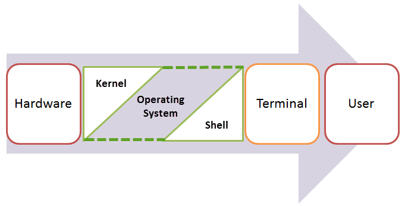
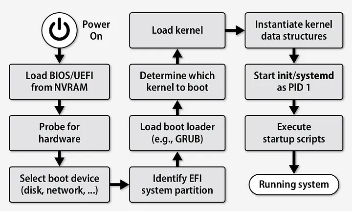
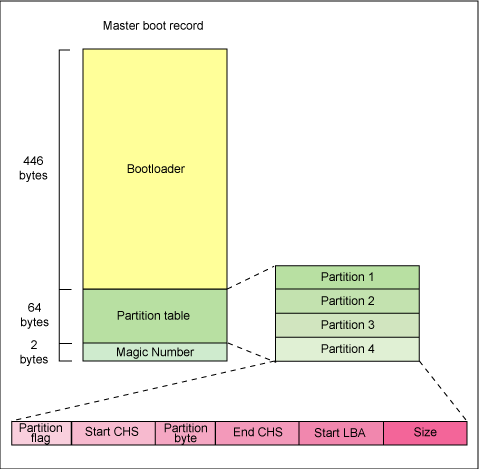
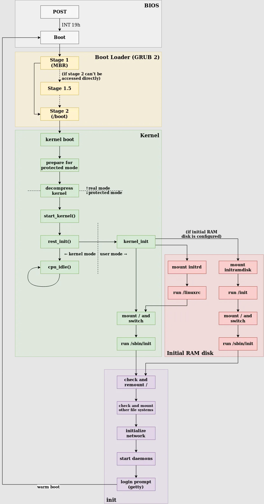
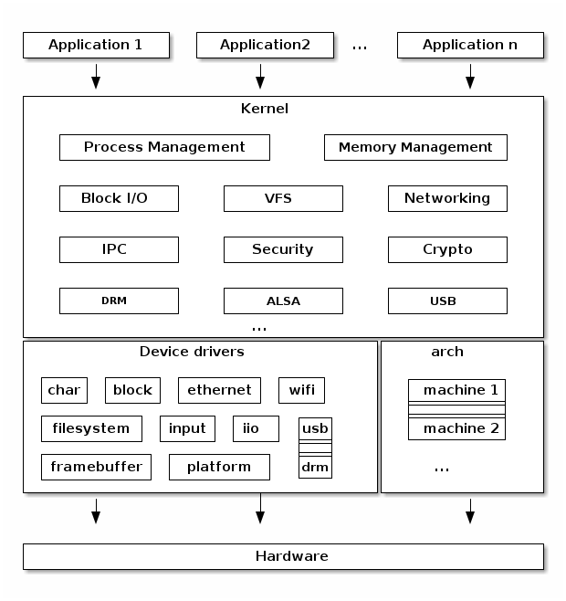
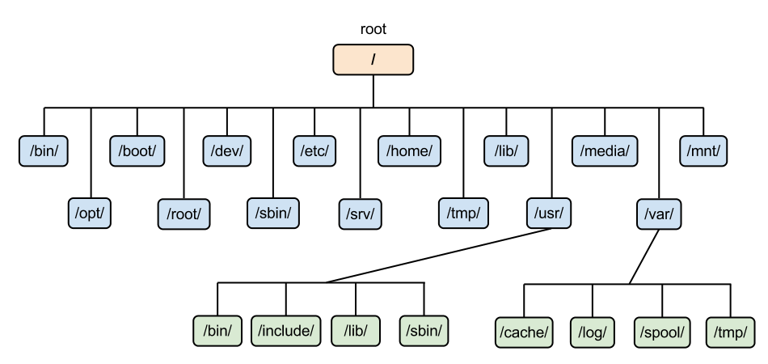
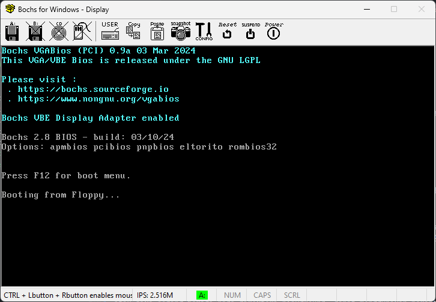
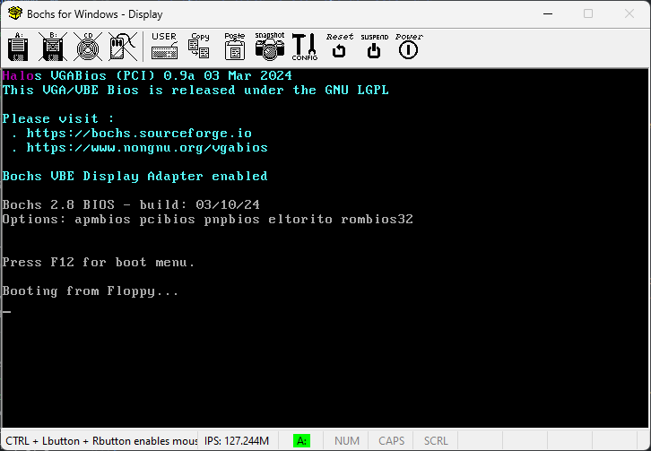

<div align=center>

# Operating System & Bootloaders

</div>

## Daftar Isi


## Sistem Operasi

### Pengertian Sistem Operasi

Sistem operasi adalah satu kesatuan perangkat yang melakukan kontrol pada perangkat komputer dan sumber daya yang dimilikinya. Komponen dari sistem operasi dapat diilustrasikan pada diagram berikut.



- **Hardware**: Merupakan perangkat keras yang digunakan oleh sistem operasi untuk menjalankan program.
- **Kernel**: Merupakan inti dari sistem operasi yang mengatur sumber daya dan menjalankan program.
- **Shell**: Merupakan antarmuka yang digunakan oleh pengguna untuk berinteraksi dengan sistem operasi.
- **Application**: Merupakan program yang dijalankan oleh sistem operasi melalui shell yang terhubung dengan kernel.

### Pengertian Kernel

Kernel adalah bagian dari sistem operasi yang tidak terlihat secara langsung, baik dalam perangkat keras maupun perangkat lunak komputer. Kernel menangani _event_ yang datang dari perangkat keras (_interrupts_) dan dari perangkat lunak (_system calls_), serta mengatur akses ke sumber daya komputer.

Contoh manajemen _event_ dari perangkat keras (_interrupt handlers_) adalah penekanan tombol pada keyboard yang kemudian akan diterjemahkan ke dalam simbol karakter bersesuaian pada buffer input. Kemudian program akan dapat mengambil karakter tersebut dari buffer input.

Sedangkan _system calls_ akan diakses oleh program, seperti membuka file, menjalankan program lain, dan sebagainya. Setiap _system call handler_ akan melakukan pengecekan kevalidan argumen yang diberikan dan kemudian melanjutkan perintah yang diberikan.

Program pada umumnya tidak akan langsung memanggil _system calls_ secara langsung, melainkan menggunakan _standard library_ untuk pemanggilannya. _Standard library_ tersebut yang nantinya akan menerjemahkan fungsi yang telah diberikan menjadi bentuk _system calls_ yang sesuai dengan apa yang dibutuhkan oleh kernel. Contohnya adalah fungsi `fopen()` pada bahasa C yang akan melakukan pemanggilan _system calls_ untuk membuka file.

Kernel bertugas untuk mengabstraksi perintah berkaitan seperti file, proses, socket, direktori, memory, dan lainnya.

### Pengertian Shell

Shell merupakan program yang biasanya terintegrasi dengan distribusi dari sistem operasi. Shell berguna sebagai antarmuka antara pengguna dengan sistem operasi. Bentuk dari shell dapat berbeda dari satu sistem operasi ke sistem operasi lainnya. Shell dapat berupa _command line interface_ (CLI) atau _graphical user interface_ (GUI).

Konsep utama dari shell adalah sebagai berikut.

- User dapat membuka program untuk dijalankan dan dapat juga memberikan argumen pada program tersebut.
- Mengizinkan user untuk melakukan operasi pada penyimpanan lokal, seperti melakukan _copy_, _move_, _delete_, dan lainnya.

Untuk melakukan tugas tersebut, shell akan memanggil beberapa _system calls_ yang akan dilanjutkan pada kernel.

### Pengertian Booting Sistem Operasi

**Booting** adalah proses yang terjadi sejak komputer dinyalakan hingga sistem operasi sepenuhnya aktif dan siap digunakan. Ini adalah tahap awal yang sangat krusial dalam kehidupan sebuah sistem operasi, karena tanpa proses booting yang berhasil, tidak ada aplikasi yang bisa dijalankan.

### Proses Booting Sistem Operasi

Proses booting sistem operasi adalah proses dimana sistem operasi dijalankan dari keadaan mati hingga siap digunakan oleh pengguna. Secara sederhana, berikut adalah proses booting sistem operasi.



#### Jenis-Jenis Booting

Terdapat dua jenis proses booting yang umum dikenal:

- Cold Boot (Hard Boot)
Merupakan proses booting dari keadaan mati total. Misalnya, saat kamu menyalakan laptop yang benar-benar mati, maka proses yang terjadi disebut cold boot.

- Warm Boot (Soft Boot)
Merupakan proses reboot dari sistem yang sedang menyala. Ini bisa dilakukan, misalnya, dengan menekan tombol restart atau menggunakan perintah reboot. Warm boot sering dilakukan setelah melakukan update sistem atau saat ada masalah kecil yang memerlukan restart.

#### Basic Input Output System (BIOS)

BIOS terdiri dari beberapa intruksi yang ditulis dalam bahasa pemrograman yang sangat _low level_. BIOS adalah program pertama yang diinstall pada komputer, bahkan sebelum sistem operasi. Ketika komputer dinyalakan, CPU akan memerintahkan BIOS untuk melakukan pengecekan pada perangkat keras dasar komputer apakah telah siap untuk digunakan atau tidak. Proses ini dinamakan **Power of Self Test** (POST). Beberapa komponen yang dicek pada POST adalah sebagai berikut.

- Perangkat keras, seperti prosesor, penyimpanan, dan juga memory.
- Perangkat input/output, seperti keyboard, mouse, dan monitor.
- Register dari CPU.
- Interrupt Controller

Setelah POST selesai dijalankan, akan dilanjutkan dengan proses booting sistem operasi. Proses booting dari storage dengan memuat sektor pertama ke memory disebut dengan **Master Boot Record** (MBR).

#### Master Boot Record (MBR)

MBR adalah sektor pertama dari sistem penyimpanan (disk/storage). Tempat fisik dari MBR terdapat pada _cylinder_ 0, _head_ 0, dan _sector_ 1. MBR menyimpan informasi tabel partisi dan juga bootloader. Bootloader adalah program yang bertugas untuk memuat sistem operasi ke dalam memory. Ukuran dari MBR adalah 512 bytes. Pada 466 bytes pertama berisi bootloader, 64 bytes berikutnya berisi tabel partisi yang terdiri dari 4 partisi masing-masing 16 bytes. Kemudian pada 2 bytes terakhir, MBR berisi _magic number_ (`0xAA55`). _Magic number_ ini digunakan untuk menandakan bahwa MBR tersebut valid.



Tugas dari MBR adalah mencari bootloader kedua pada tabel partisi. Setelah menemukan bootloader kedua, MBR akan memuat bootloader kedua tersebut ke dalam memory dan akan dieksekusi.

#### Kernel Loader

Bootloader kedua yang dimuat oleh MBR adalah kernel loader. Kernel loader bertugas untuk memuat kernel dari sistem operasi ke dalam memory. Kernel loader akan memuat kernel ke dalam memory dan akan menjalankan kernel tersebut.

Pada linux, kernel loader yang digunakan adalah GRUB (Grand Unified Bootloader). GRUB adalah bootloader yang bersifat open source dan dapat digunakan pada berbagai sistem operasi. GRUB memiliki beberapa fitur yang berguna, seperti _multiboot_, _multiboot2_, dan _chainloading_.

Hal tersebut dilakukan karena pada kernel loader modern seperti GRUB, tidak cukup jika dimasukkan kedalam 466 bytes di MBR. Sehingga MBR perlu mencari bootloader kedua yang akan memuat kernel ke dalam memory.

Berikut adalah ilustrasi dari proses booting sistem operasi linux.



### Pengertian Interrupts

Interrupts adalah mekanisme yang digunakan oleh CPU untuk memberitahu bahwa ada _event_ yang terjadi. Interrupts digunakan untuk menghentikan eksekusi program yang sedang berjalan dan menjalankan _interrupt handler_ yang sesuai dengan _event_ yang terjadi.

_Interrupt handler_ atau _Interrupt Service Routine_ (ISR) dapat dianalogikan dengan _event listener_ pada _event-driven programming_ yang umumnya digunakan pada bahasa pemrograman _high-level_ seperti javascript. ISR adalah _event handler_ untuk interrupts yang terjadi. Setiap interrupt memiliki kode terkait yang menandakan _event_ yang terjadi. Kode ini disebut dengan _interrupt vector_. Instruksi untuk interrupt pada x86 adalah `int n` dimana `n` adalah vector dari interrupt. Vector interrupt dapat dituliskan dalam notasi heksadesimal (0x00 - 0xFF) atau notasi vector (00h - FFh).

Penjelasan lebih lanjut mengenai interrupts dapat dilihat [di sini](https://en.wikipedia.org/wiki/BIOS_interrupt_call).

Impelementasi interrupts yang akan digunakan pada praktikum adalah service `int 21h` yang digunakan untuk melakukan _interrupt_ pada kernel DOS. Dengan melakukan pemanggilan `int 21h` menggunakan parameter tertentu (seperti AH dan AL), kita dapat melakukan berbagai akses input output pada sistem operasi DOS.

## Kernel Linux



Kernel Linux adalah inti dari sistem operasi Linux. Ia mengatur interaksi antara perangkat keras dan perangkat lunak, serta menangani tugas-tugas penting seperti manajemen memori, proses, sistem file, dan perangkat input/output. Kernel inilah yang pertama kali dijalankan setelah bootloader memuatnya ke dalam memori.

Salah satu keunggulan kernel Linux adalah sifatnya yang open-source dan modular. Siapa saja bisa melihat, memodifikasi, dan mengompilasi ulang kernel sesuai kebutuhan. Ini membuatnya ideal untuk keperluan pembelajaran, eksperimen, dan pengembangan sistem operasi yang disesuaikan seperti yang akan kita lakukan dalam modul ini.

Dalam praktiknya, kita tidak perlu menulis kernel dari nol. Kita cukup mengambil kode sumber kernel Linux resmi, lalu menyusunnya (compile) menjadi file biner bzImage yang bisa dieksekusi oleh bootloader dan dieksekusi oleh QEMU. Proses penyusunan kernel ini membutuhkan beberapa dependensi sistem serta konfigurasi awal untuk menentukan fitur-fitur yang akan dimasukkan ke dalam kernel hasil build.

### Persiapan Kernel

Pada tahap ini, kita akan mempersiapkan kernel Linux yang akan digunakan untuk membangun sistem operasi minimal menggunakan **QEMU**.

QEMU adalah emulator open-source yang memungkinkan kita untuk menjalankan sistem operasi di dalam lingkungan virtual. Dengan QEMU, kita bisa menguji kernel yang telah kita buat tanpa perlu menginstalnya secara langsung di perangkat keras. Pengertian lebih lanjut terkait QEMU akan dibahas di bagian yang berbeda.

Langkah-langkah yang perlu dilakukan antara lain mengupdate dan menginstall software pendukung, mengunduh kode sumber kernel, melakukan konfigurasi kernel sesuai kebutuhan, serta mengkompilasi kernel untuk menghasilkan file `bzImage`.

1. Update dan Install Software Pendukung

    Sebelum memulai, pastikan sistem telah diperbarui dan semua perangkat lunak yang dibutuhkan untuk proses ini terinstall. Kita akan menggunakan beberapa tools seperti qemu, build-essential, bison, flex, dan lainnya.

    ```
    sudo apt -y update
    sudo apt -y install qemu-system build-essential bison flex libelf-dev libssl-dev bc grub-common grub-pc libncurses-dev libssl-dev mtools grub-pc-bin xorriso tmux
    ```

2. Buat Direktori Booting

    Buat sebuah direktori untuk proyek ini dan pindah ke direktori tersebut. Semua proses pembuatan dan konfigurasi kernel akan dilakukan di dalam direktori ini.

    ```
    mkdir -p osboot
    cd osboot
    ```

3. Download dan Ekstrak Kernel Linux

    Langkah berikutnya adalah mengunduh kode sumber kernel Linux versi 6.1.1. Setelah mengunduhnya, kita akan mengekstraknya ke dalam direktori linux-6.1.1.

    ```sh
    wget https://cdn.kernel.org/pub/linux/kernel/v6.x/linux-6.1.1.tar.xz
    tar -xvf linux-6.1.1.tar.xz
    cd linux-6.1.1
    ```

4. Konfigurasi Kernel

    Kernel Linux perlu dikonfigurasi sebelum dikompilasi. Kita akan memulai dengan menggunakan konfigurasi minimal menggunakan make tinyconfig. Setelah itu, kita bisa menyesuaikan konfigurasi lebih lanjut dengan menggunakan make menuconfig untuk mengaktifkan fitur-fitur yang diperlukan oleh sistem operasi yang akan kita buat. Beberapa pengaturan yang penting untuk diaktifkan adalah dukungan untuk virtualisasi, file systems, driver perangkat, serta jaringan.

    ```
    64-Bit Kernel
    General Setup > Configure standard kernel features > Enable support for printk
    General Setup > Configure standard kernel features > Enable futex support
    General Setup > Initial RAM filesystem and RAM disk (initramfs/initrd) support
    General Setup > Control Group Support
    Enable the block layer > Legacy autoloading support
    Enable the block layer > Partition type > Advanced Partition Selection
    Device Drivers > Character devices > Enable TTY
    Device Drivers > Character devices > Virtio console
    Device Drivers > Character devices > /dev/mem virtual device support
    Device Drivers > Network device support > Virtio Network Driver
    Device Drivers > Serial Ata / Paralel ATA
    Device Drivers > Block Devices > Virtio block driver
    Device Drivers > Block Devices > loopback device support
    Device Drivers > Block Devices > RAM block device support
    Device Drivers > Virtio drivers
    Device Drivers > Virtualization Drivers
    Device Drivers > Generic  Driver Options > Maintain a devtmpfs at filesystems
    Device Drivers > Generic Driver Options > Automount devtmpfs at /dev
    Executable file formats > Kernel Support for ELF binaries
    Executable file formats > Kernel Support scripts starting with #!
    File Systems > FUSE support
    File Systems > The extended 3 filesystem
    File Systems > The extended 4 filesystem
    File Systems > Second extended fs support
    File Systems > Virtio Filesystem
    File Systems > Kernel automounter support
    File Systems > Pseudo File Systems > /proc file system support
    File Systems > Pseudo File Systems > sysctl support
    File Systems > Pseudo File Systems > sysfs file system support
    Networking Support > Networking options > Unix domain sockets
    Networking Support > Networking options > TCP/IP Networking
    ```

    Konfigurasi ini akan memastikan bahwa kernel yang dihasilkan dapat bekerja dengan baik di lingkungan virtual dan mendukung operasi dasar yang diperlukan.

    ```
    make tinyconfig
    make menuconfig
    ```

    Setelah selesai mengonfigurasi, kamu bisa langsung menyimpan file konfigurasi .config dan melanjutkan ke langkah berikutnya.

5. Compile Kernel

    Dengan konfigurasi yang sudah siap, kini kita bisa memulai proses kompilasi kernel. Proses kompilasi ini akan menghasilkan file bzImage, yang merupakan file kernel yang siap digunakan untuk booting.

    make -j$(nproc)

    Perintah di atas akan mengkompilasi kernel menggunakan seluruh inti CPU yang tersedia pada sistem.

6. Generate File `bzImage`

    Setelah kompilasi selesai, kita akan mendapatkan file bzImage di dalam direktori arch/x86/boot/. Pindahkan file ini ke direktori osboot untuk persiapan langkah selanjutnya, yaitu pembuatan root filesystem dan emulasi menggunakan QEMU.

    ```sh
    cp arch/x86/boot/bzImage ..
    ```

### Membuat Root File System

Root Filesystem adalah struktur berkas yang digunakan oleh sistem operasi untuk menyimpan file-file esensial yang diperlukan untuk menjalankan sistem, seperti konfigurasi, perangkat keras, dan aplikasi dasar.

Ini adalah filesystem pertama yang dimuat setelah proses booting dimulai dan menjadi pusat penyimpanan bagi semua file penting yang dibutuhkan oleh sistem.



Root filesystem biasanya berisi beberapa direktori penting, antara lain:

- /bin – Menyimpan aplikasi dan program dasar yang digunakan untuk menjalankan sistem.
- /etc – Menyimpan file konfigurasi sistem dan aplikasi.
- /lib – Berisi pustaka sistem yang diperlukan oleh program untuk dijalankan.
- /dev – Menyimpan file perangkat yang diperlukan untuk mengakses hardware.
- /home – Direktori tempat menyimpan data pengguna.

#### Initial RAM Filesystem (initramfs)

Sebelum root filesystem utama bisa dipasang, sistem membutuhkan suatu filesystem sementara yang disebut initramfs untuk memulai sistem operasi. Initramfs adalah sebuah image filesystem yang sangat ringan yang dimuat ke dalam memori pada saat awal booting.

**Fungsi Initramfs:**

- Menyediakan alat dasar dan skrip untuk mempersiapkan sistem.
- Mengonfigurasi perangkat keras dan memeriksa perangkat penyimpanan.
- Menyediakan kernel dengan informasi yang dibutuhkan untuk memasang root filesystem utama.

#### BusyBox

Untuk mempermudah tugas-tugas dalam initramfs, BusyBox digunakan sebagai kumpulan alat yang sangat ringan namun lengkap. BusyBox menyediakan berbagai utilitas sistem yang digunakan untuk mengonfigurasi perangkat keras, memanipulasi sistem berkas, dan melakukan tugas penting lainnya selama proses booting.

**Fungsi BusyBox:**

- Mengganti banyak perintah standar Linux yang ada di sistem operasi dengan versi yang lebih ringan dan sederhana.
- Berfungsi dalam lingkungan terbatas sumber daya (seperti sistem embedded atau tahap awal booting).
- Menyediakan utilitas seperti ls, cp, mv, mount, dan banyak lainnya, yang digunakan oleh initramfs untuk melakukan berbagai tugas.

**Instalasi BusyBox**

```
sudo apt install -y busybox-static
```

### Single User vs Multi User

Sistem operasi Linux dapat dijalankan dalam dua mode utama berdasarkan kebutuhan pengguna dan kompleksitas sistem: **Single User** dan **Multi User**. Keduanya menggunakan root file system sebagai pondasi sistem, namun memiliki pendekatan, struktur, dan proses booting yang berbeda.

Mode **Single User** cocok untuk keperluan pemeliharaan sistem atau debugging karena hanya memperbolehkan satu pengguna (biasanya root) untuk mengakses sistem. Sementara itu, mode **Multi User** dirancang agar beberapa pengguna bisa login dan bekerja secara bersamaan, dengan pengelolaan hak akses, akun, dan layanan sistem yang lebih kompleks.

#### Perbandingan: Single User vs Multi User

1. Dari Sisi Fungsi

   | Aspek              | Single User                                                                   | Multi User                                                                            |
   | ------------------ | ----------------------------------------------------------------------------- | ------------------------------------------------------------------------------------- |
   | **Tujuan**         | Digunakan untuk pemeliharaan, debugging, atau sistem minimal.                 | Digunakan untuk penggunaan sehari-hari, server, atau sistem dengan banyak pengguna.   |
   | **Akses Pengguna** | Hanya satu pengguna (biasanya root) yang dapat login.                         | Banyak pengguna bisa login secara bersamaan dengan hak akses berbeda.                 |
   | **Interaksi**      | Tidak ada interaksi antar pengguna, fokus pada tugas sistem dasar.            | Mendukung interaksi antar pengguna dan proses secara paralel.                         |
   | **Keamanan**       | Minim pengaturan keamanan karena hanya root yang akses.                       | Perlu sistem autentikasi, manajemen user, dan hak akses untuk masing-masing pengguna. |
   | **Kegunaan**       | Praktis untuk recovery, tes booting, atau sistem embedded yang sangat ringan. | Umum pada sistem desktop, server, atau lingkungan kerja yang melibatkan banyak user.  |

2. Dari Sisi Pembuatan Sistem

   **Single User**

   - **Struktur Root File System:**
     - Minimal: `/bin`, `/dev`, `/proc`, `/sys`, dan file `init`.
     - Tidak ada direktori pengguna (`/home`, `/etc/passwd`, dll).
   - **File `init`:**
     - Sederhana. Biasanya hanya berisi:
       ```sh
       #!/bin/sh
       echo "Init started"
       exec /bin/sh
       ```
     - Setelah mounting, langsung masuk ke shell sebagai root tanpa proses login.
   - **Manajemen User:** Tidak diperlukan, karena hanya root yang menjalankan shell.
   - **Proses Booting:** Cepat dan sederhana, tidak ada daemon login atau manajemen hak akses.

   **Multi User**

   - **Struktur Root File System:**
     - Lebih lengkap: Menyertakan `/etc/passwd`, `/etc/group`, `/etc/shadow`, `/home/user1`, dll.
     - Menggunakan BusyBox untuk `login`, `adduser`, `getty`, dan tool manajemen sistem lainnya.
   - **File `init`:**
     - Lebih kompleks, karena harus menjalankan proses login melalui `getty`:
       ```sh
       #!/bin/sh
       mount -t proc none /proc
       mount -t sysfs none /sys
       mount -t devtmpfs none /dev
       /bin/hostname multiuser
       setsid /bin/getty -n -l /bin/login 115200 tty1 &
       exec /bin/sh
       ```
     - Proses login aktif di `tty1`, dan bisa ditambah untuk `tty2`, `tty3`, dst.
   - **Manajemen User:**
     - Harus membuat user dan grup menggunakan `adduser` atau manual edit `/etc/passwd`.
     - Password bisa dienkripsi atau dibuat kosong tergantung konfigurasi BusyBox.
   - **Proses Booting:** Sistem menjalankan login prompt pada beberapa terminal (multi-console). Setelah login, setiap user mendapatkan shell-nya masing-masing sesuai hak akses.

3. Ringkasan Perbedaan

   | Aspek                        | Single User                                  | Multi User                                            |
   | ---------------------------- | -------------------------------------------- | ----------------------------------------------------- |
   | **Tujuan Utama**             | Pemeliharaan / sistem minimal                | Sistem siap pakai oleh banyak user                    |
   | **Akses**                    | Hanya root                                   | Banyak user dengan login                              |
   | **Kompleksitas File System** | Sederhana                                    | Lengkap dengan konfigurasi user                       |
   | **File Init**                | Shell langsung                               | Proses login via getty                                |
   | **Direktori Tambahan**       | Tidak diperlukan `/etc/passwd`, `/home`, dll | Wajib menyertakan direktori dan file konfigurasi user |
   | **Manajemen User**           | Tidak ada                                    | Perlu sistem autentikasi                              |
   | **Contoh Kasus**             | Rescue mode, sistem embedded                 | Server, multi-user workstation                        |

Kesimpulan

Perbedaan utama antara **single user** dan **multi user** tidak hanya terletak pada jumlah pengguna yang bisa login, tapi juga pada tingkat kompleksitas sistem yang dibangun. Mode **single user** menawarkan kesederhanaan dan kecepatan, ideal untuk kondisi darurat atau sistem embedded yang ringan. Sementara itu, mode **multi user** membutuhkan konfigurasi tambahan, namun memberikan fleksibilitas dan skalabilitas lebih besar yang cocok untuk sistem produksi.

### Single User

Setelah mempersiapkan kernel dan root filesystem, kita akan melanjutkan ke pembuatan sistem file yang lebih sederhana yang berfungsi untuk tahap awal booting, yaitu Single User Mode. Pada mode **Single User**, root filesystem yang telah disiapkan akan dijalankan dengan hanya satu pengguna yang memiliki kontrol penuh terhadap sistem. Mode ini berguna pada tahap awal booting atau untuk sistem yang lebih sederhana, seperti embedded systems, di mana hanya satu pengguna yang diperlukan untuk mengonfigurasi atau mengelola sistem. Berikut adalah penjelasan lebih lanjut tentang bagaimana root filesystem bekerja dalam mode single user, beserta langkah-langkah yang dapat diikuti untuk membuat root filesystem ini.

#### Konsep Root Filesystem dalam Mode Single User

1. **Peran Program `init`**

   - Setelah kernel Linux memulai proses booting, langkah pertama yang dilakukan adalah menjalankan program **init**. Program **init** ini adalah program pertama yang dijalankan oleh kernel dengan Process ID (PID) 1.
   - **init** bertanggung jawab untuk menyiapkan lingkungan yang dibutuhkan oleh sistem dan memulai proses lainnya dalam urutan yang tepat.
   - Root filesystem yang dimuat pertama kali oleh kernel akan menyertakan program **init**, yang biasanya terletak di dalam direktori root (`/`).

2. **Penggunaan Initramfs dalam Single User**

   - Untuk mempermudah proses booting, root filesystem dapat dimuat menggunakan **initramfs**. Initramfs adalah sebuah **filesystem sementara** yang dimuat ke dalam memori dan berfungsi untuk mempersiapkan sistem sebelum root filesystem utama dipasang.
   - Dalam kasus ini, **initramfs** digunakan untuk mengonfigurasi sistem dan menyediakan alat minimal yang dibutuhkan, seperti BusyBox, untuk menjalankan program **init** dalam mode single user.

3. **Mengapa Menggunakan BusyBox**

   - Pada sistem operasi yang lebih kompleks, root filesystem biasanya disimpan pada penyimpanan permanen seperti hard drive atau SSD. Namun, dalam proses booting awal atau pada sistem dengan sumber daya terbatas, kita menggunakan **BusyBox**.
   - **BusyBox** adalah kumpulan utilitas Unix/Linux yang dikemas dalam satu file eksekusi. Ini memungkinkan sistem yang lebih ringan dengan menyediakan berbagai perintah penting seperti `ls`, `cp`, `mount`, dan `sh`, yang digunakan untuk mengonfigurasi dan mengelola filesystem.

#### Langkah-Langkah Pembuatan Root File System untuk Single User Mode

Berikut adalah langkah-langkah pembuatan root filesystem yang menggunakan initramfs dan BusyBox untuk menyediakan lingkungan sistem yang minimal namun fungsional.

1. **Masuk ke Mode Superuser**

   Untuk membuat perubahan pada sistem, kita akan bekerja dalam mode superuser (root). Gunakan perintah berikut untuk masuk ke shell sebagai root:

   ```bash
   sudo bash
   ```

2. **Buat Direktori untuk Initramfs**

   Selanjutnya, kita buat direktori `myramdisk` dan beberapa sub-direktori untuk sistem file:

   ```bash
   mkdir -p myramdisk/{bin,dev,proc,sys}
   ```

   Struktur direktori ini akan terlihat seperti ini:

   ```
   myramdisk/
     ├── bin/
     ├── dev/
     ├── proc/
     └── sys/
   ```

3. **Salin File Device ke Direktori `dev`**

   Direktori `/dev` di Linux berisi file perangkat penting seperti `null`, `tty`, `zero`, dan `console`. Kita akan menyalinnya dari sistem host ke dalam direktori `dev` di `myramdisk`.

   ```bash
   cp -a /dev/null myramdisk/dev
   cp -a /dev/tty* myramdisk/dev
   cp -a /dev/zero myramdisk/dev
   cp -a /dev/console myramdisk/dev
   ```

4. **Salin File BusyBox ke Direktori `bin`**

   Selanjutnya, kita akan menyalin file **BusyBox** ke direktori `bin` yang telah dibuat di dalam `myramdisk`. Kemudian, kita akan menginstal semua utilitas yang disediakan oleh BusyBox:

   ```bash
   cp /usr/bin/busybox myramdisk/bin
   cd myramdisk/bin
   ./busybox --install .
   ```

   Perintah ini akan menambahkan berbagai perintah Unix/Linux seperti `ls`, `cp`, `mv`, `mount`, dan banyak lainnya ke dalam direktori `bin`.

5. **Buat File `init`**

   Di dalam direktori `myramdisk`, buat file **init** yang akan dijalankan pertama kali saat booting. Isi file ini dengan instruksi untuk melakukan mounting sistem file dan memulai shell interaktif.

   ```bash
   #!/bin/sh
   /bin/mount -t proc none /proc
   /bin/mount -t sysfs none /sys
   exec /bin/sh
   ```

   File ini akan melakukan mounting untuk `proc` dan `sysfs`, yang memungkinkan sistem berkomunikasi dengan kernel. Setelah itu, akan memulai shell `/bin/sh` untuk interaksi pengguna.

6. **Berikan Izin Eksekusi pada File `init`**

   Agar file `init` dapat dieksekusi, kita perlu memberikan izin eksekusi dengan perintah:

   ```bash
   chmod +x init
   ```

7. **Kompresi dan Buat File `initramfs`**

   Setelah menyiapkan semua file yang diperlukan, langkah berikutnya adalah mengumpulkan file-file tersebut menggunakan perintah `cpio` dan mengompresnya dengan `gzip` untuk membuat image initramfs.

   ```bash
   find . | cpio -oHnewc | gzip > ../myramdisk.gz
   ```

   Perintah ini akan menghasilkan file **myramdisk.gz**, yang berisi sistem file minimal untuk tahap awal booting.

Dengan langkah-langkah di atas, kita telah berhasil membuat root filesystem dalam mode single user dengan menggunakan BusyBox dan initramfs.

### Multi User

Setelah sistem berhasil dijalankan dalam mode **single user**, tahap selanjutnya adalah membangun sistem dalam mode **multi user** menggunakan **initramfs**. Pada mode ini, lebih dari satu pengguna dapat login dan menggunakan sistem secara bersamaan, sehingga cocok untuk penggunaan umum yang membutuhkan manajemen akun dan akses.

<div align="center">
  
</div>

Untuk mendukung multi user, kita akan menyusun root file system yang lebih lengkap. Kita menggunakan **BusyBox** sebagai penyedia utilitas dasar Linux, dan **initramfs** sebagai sistem file root yang dimuat ke memori saat booting. Berbeda dengan single user yang hanya menyediakan shell langsung untuk root, mode ini memerlukan proses login di terminal, sehingga dibutuhkan file seperti `/etc/passwd`, `/etc/group`, dan layanan seperti `getty`.

#### Langkah-Langkah Pembuatan Root File System dengan Multi User

1. **Masuk ke Mode Privileged (Superuser)**

   Agar bisa membuat perubahan pada sistem, kita akan bekerja dalam mode **superuser** (root) dengan perintah:

   ```bash
   sudo bash
   ```

2. **Buat Direktori untuk Initramfs**

   Buat direktori dengan nama `myramdisk` dan beberapa sub-direktori yang diperlukan oleh sistem file root.

   ```bash
   mkdir -p myramdisk/{bin,dev,proc,sys,etc,root,home/user1}
   ```

3. **Salin File Device ke Direktori `dev`**

   Direktori `/dev` berisi perangkat penting seperti `null`, `tty`, `zero`, dan `console`. Kita akan menyalin file-file perangkat ini dari sistem host ke dalam direktori `dev` di `myramdisk`.

   ```bash
   cp -a /dev/null myramdisk/dev
   cp -a /dev/tty* myramdisk/dev
   cp -a /dev/zero myramdisk/dev
   cp -a /dev/console myramdisk/dev
   ```

4. **Salin BusyBox ke Direktori `bin`**

   Salin file **BusyBox** ke direktori `bin` dan jalankan instalasi utilitas BusyBox:

   ```bash
   cp /usr/bin/busybox myramdisk/bin
   cd myramdisk/bin
   ./busybox --install .
   ```

5. **Buat Password Root**

   Gunakan perintah `openssl` untuk membuat password root yang dienkripsi:

   ```bash
   openssl passwd -1 myrootpassword
   ```

   Salin hasil yang keluar dari perintah di atas, karena ini akan digunakan untuk membuat database user dan password.

6. **Buat File `passwd` di Direktori `etc`**

   Buat file `passwd` di direktori `etc` untuk menyimpan informasi tentang akun root dan user yang akan kita buat (misalnya `user1`):

   ```bash
   root:<<hasilgeneratorrootpassword>>:0:0:root:/root:/bin/sh
   user1:<<hasilgeneratorrootpassword>>:1001:100:user1:/home/user1:/bin/sh
   ```

7. **Buat File `group` di Direktori `etc`**

   Buat file `group` di direktori `etc` yang berisi pengaturan grup untuk user yang baru dibuat:

   ```bash
   root:x:0:
   bin:x:1:root
   sys:x:2:root
   tty:x:5:root,user1
   disk:x:6:root
   wheel:x:10:root,user1
   users:x:100:user1
   ```

8. **Buat File `init`**

   Kembali ke direktori `myramdisk`, buat file **init** yang akan dipanggil oleh bootloader saat sistem booting. Isi file `init` dengan instruksi untuk melakukan mounting sistem file dan menjalankan proses login:

   ```bash
   #!/bin/sh
   /bin/mount -t proc none /proc
   /bin/mount -t sysfs none /sys

   while true
   do
       /bin/getty -L tty1 115200 vt100
       sleep 1
   done
   ```

   File ini akan melakukan mounting untuk `proc` dan `sysfs`, yang memungkinkan komunikasi antara user space dan kernel. Kemudian, perintah `getty` akan menunggu input login dari pengguna melalui konsol.

9. **Berikan Izin Eksekusi pada File `init`**

   Agar file `init` bisa dieksekusi, kita perlu memberikan izin eksekusi pada file tersebut:

   ```bash
   chmod +x init
   ```

10. **Kompresi dan Buat File `initramfs`**

    Setelah menyiapkan semua file yang diperlukan, kita akan mengumpulkan file-file tersebut menggunakan utilitas **cpio** dan kemudian mengompresnya dengan **gzip** untuk membuat image **initramfs**.

    ```bash
    find . | cpio -oHnewc | gzip > ../myramdisk.gz
    ```

    Perintah ini akan menghasilkan file **myramdisk.gz** yang berisi sistem file minimal untuk booting.

Dengan langkah-langkah di atas, kita telah berhasil membuat root filesystem dengan kemampuan multi-user menggunakan initramfs dan BusyBox. Sistem ini memungkinkan beberapa pengguna untuk login, dengan satu pengguna utama (root) dan satu pengguna tambahan (user1). Ketika sistem boot, pengguna dapat login menggunakan kredensial yang telah kita tentukan.

## Emulasi dengan QEMU

### Pengertian QEMU

**QEMU** (Quick Emulator) adalah program yang digunakan untuk menjalankan **sistem operasi** atau **aplikasi** di dalam **lingkungan virtual** (mirip dengan komputer lain) tanpa memerlukan perangkat keras fisik yang berbeda. Dengan QEMU, kita bisa menjalankan sistem operasi yang berbeda, seperti Linux di atas Windows, atau mencoba sistem yang sama sekali berbeda, misalnya ARM atau RISC-V, di atas mesin berbasis x86 (komputer biasa).

Bayangkan kamu ingin mencoba sistem yang berbeda, misalnya kamu ingin menguji **Windows 10** di atas **Mac**. Daripada menginstal Windows di hard drive Mac secara langsung (yang bisa memakan waktu dan berisiko), kamu bisa menggunakan QEMU untuk **"meniru"** mesin Windows di dalam Mac, sehingga kamu bisa menguji Windows 10 tanpa mengganti apa pun di komputer asli.

QEMU bekerja dengan **meniru** (emulasi) komponen-komponen dalam komputer seperti **CPU** (prosesor), **memori**, dan **perangkat keras** lainnya. Dengan begitu, kamu bisa menjalankan sistem operasi atau aplikasi yang biasanya hanya bisa berjalan di mesin tertentu, tanpa memerlukan perangkat keras yang sesuai.

#### Perbedaan antara QEMU dan Virtual Machine (VM)

**QEMU** dan **Virtual Machine (VM)** sering kali digunakan untuk hal yang sama, yaitu menjalankan sistem operasi yang berbeda, tetapi keduanya berbeda dalam cara kerjanya.

1. **Virtual Machine (VM)**

   - **Apa itu VM?** VM adalah **mesin virtual** yang berjalan di atas sistem operasi utama. Dengan VM, kamu membuat **mesin virtual** yang berfungsi seperti komputer fisik terpisah. Kamu bisa menjalankan sistem operasi (misalnya Linux) di atas sistem operasi lain (misalnya Windows) dengan menggunakan program seperti **VirtualBox** atau **VMware**.
   - **Cara Kerja VM**: Mesin virtual menggunakan **virtualisasi** untuk membagi sumber daya komputer fisik (seperti CPU, RAM) ke dalam beberapa mesin virtual. Jadi, meskipun semua mesin virtual berbagi komputer fisik yang sama, mereka bekerja seolah-olah mereka memiliki komputer sendiri.

2. **QEMU**

   - **Apa itu QEMU?** QEMU adalah **emulator** yang lebih fleksibel. QEMU bisa melakukan **emulasi** penuh dari komputer, yang berarti dia bisa meniru **perangkat keras** (seperti CPU dan perangkat lainnya) dari mesin lain. Ini memungkinkan kita untuk menjalankan sistem operasi yang dirancang untuk perangkat keras yang berbeda (misalnya ARM, MIPS) di atas mesin yang berbeda (misalnya x86).
   - **Cara Kerja QEMU**: QEMU tidak hanya **virtualisasi** tetapi juga **emulasi**. Artinya, QEMU bisa "meniru" perangkat keras secara penuh, memungkinkan kita menjalankan berbagai jenis sistem operasi tanpa memerlukan mesin fisik yang sesuai.

3. **Perbandingan QEMU dan VM**

   | **Aspek**             | **QEMU**                                                                          | **VM**                                                                                                 |
   | --------------------- | --------------------------------------------------------------------------------- | ------------------------------------------------------------------------------------------------------ |
   | **Jenis Teknologi**   | Emulasi (meniru perangkat keras)                                                  | Virtualisasi (menggunakan sumber daya bersama)                                                         |
   | **Fungsi Utama**      | Menjalankan sistem operasi dari arsitektur yang berbeda                           | Menjalankan sistem operasi dengan membagi sumber daya komputer                                         |
   | **Contoh Penggunaan** | Menjalankan sistem operasi untuk arsitektur yang berbeda (misal: ARM di atas x86) | Menjalankan berbagai sistem operasi di satu mesin fisik (misal: Windows dan Linux dalam satu komputer) |

### Langkah-Langkah Emulasi dengan QEMU

Setelah membuat file `bzImage` (kernel) dan `myramdisk.gz` (initramfs), kita bisa menjalankan sistem operasi hasil build kita menggunakan **QEMU**. Berikut langkah-langkah yang perlu dilakukan:

1. Pindah ke Direktori `osboot`

   Pertama, masuk ke direktori tempat kamu menyimpan file hasil build:

   ```bash
   cd osboot
   ```

   Direktori ini seharusnya berisi file berikut:

   - `bzImage` → kernel hasil kompilasi
   - `myramdisk.gz` → root filesystem yang telah dibuat

2. Jalankan Emulasi dengan QEMU

   Gunakan perintah berikut untuk menjalankan QEMU dengan konfigurasi tertentu:

   ```bash
   qemu-system-x86_64 \
   -smp 2 \
   -m 256 \
   -display curses \
   -vga std \
   -kernel bzImage \
   -initrd myramdisk.gz
   ```

   Penjelasan Opsi:

   | Opsi                   | Fungsi                                                                |
   | ---------------------- | --------------------------------------------------------------------- |
   | `-smp 2`               | Menyediakan 2 vCPU (virtual CPU) untuk sistem yang diemulasi          |
   | `-m 256`               | Memberikan alokasi memori sebesar 256 MB                              |
   | `-display curses`      | Menampilkan output dalam mode teks (bisa digunakan di terminal biasa) |
   | `-vga std`             | Mengatur tampilan VGA standar (80x25), cukup untuk tampilan teks      |
   | `-kernel bzImage`      | Menentukan kernel yang akan digunakan untuk booting                   |
   | `-initrd myramdisk.gz` | Menentukan root filesystem (initramfs) yang akan dimuat               |

Setelah menjalankan perintah di atas, QEMU akan mulai melakukan proses booting. Jika tidak ada kesalahan, kamu akan masuk ke shell BusyBox (jika menggunakan `init` yang diarahkan ke shell), atau melihat proses login jika menggunakan konfigurasi multi-user.

### Pengujian di Dalam Shell

Setelah sistem berhasil boot melalui QEMU, kamu akan melihat tampilan shell atau prompt login tergantung apakah kamu menggunakan mode **single user** atau **multi user**.

#### **Single User**

Kamu akan langsung masuk ke shell `sh` yang disediakan oleh **BusyBox**. Ini artinya sistem hanya menyediakan akses langsung ke terminal tanpa proses login.

Contoh tampilan:

```
/ #
```

Di sini kamu bisa mencoba beberapa perintah dasar Linux seperti:

```sh
ls
cat /proc/cpuinfo
echo "Hello dari QEMU!"
```

Tujuannya adalah memastikan bahwa:

- File system berhasil dimuat
- BusyBox berjalan dengan baik
- Sistem responsif terhadap input

#### **Multi User**

Pada mode ini, kamu akan melihat prompt login. Sistem akan meminta kamu untuk masuk menggunakan username dan password yang sesuai dengan yang telah kamu konfigurasikan sebelumnya (misalnya di file `/etc/passwd` dan `/etc/shadow`).

Contoh tampilan:

```
Welcome to Mini Linux
myos login: user1
Password:
```

Setelah berhasil login, kamu akan masuk ke shell dan bisa melakukan pengujian seperti:

```sh
whoami
ls /home
```

Hal yang perlu diuji:

- Proses login berjalan dengan benar
- Hak akses pengguna sesuai (tidak bisa akses direktori root tanpa izin)
- Bisa berpindah direktori dan menjalankan perintah dasar

### Mengulang Proses Booting

Jika kamu ingin **mengulang proses booting** sistem yang telah kamu emulasikan dengan QEMU, kamu perlu menghentikan proses QEMU terlebih dahulu, lalu menjalankannya kembali seperti sebelumnya.

1. **Matikan proses QEMU**

   Gunakan perintah berikut untuk menghentikan proses QEMU:

   ```sh
   pkill -f qemu
   ```

   Perintah ini akan mencari proses yang mengandung kata “qemu” dan menghentikannya. Pastikan kamu tidak sedang menjalankan proses penting lain yang juga mengandung kata tersebut.

2. **Jalankan kembali sistem menggunakan QEMU**

   Ulangi perintah QEMU yang sama seperti sebelumnya:

   ```sh
   qemu-system-x86_64 \
     -smp 2 \
     -m 256 \
     -display curses \
     -vga std \
     -kernel bzImage \
     -initrd myramdisk.gz
   ```

Ini akan mem-boot ulang sistem dari awal dengan pengaturan yang sama, memungkinkan kamu untuk menguji kembali apakah sistem berjalan stabil dan seperti yang diharapkan.

## Membuat ISO Bootable Disk

**ISO bootable disk** adalah sebuah file berformat `.iso` yang berisi salinan struktur sistem file lengkap dari sistem operasi dan dapat digunakan untuk melakukan **booting**. File ini bisa dijalankan lewat emulator seperti QEMU, diburning ke CD/DVD, atau ditulis ke USB untuk menjalankan sistem secara langsung (live system).

Membuat ISO ini berguna untuk:

- **Distribusi sistem operasi** buatan sendiri
- **Pengujian dan deployment cepat** ke mesin lain
- Membuat **live Linux minimal** hasil kustomisasi kita sendiri

Agar file ISO bisa digunakan untuk booting, kita memerlukan **bootloader**, yaitu program awal yang dijalankan saat komputer menyala. Di sini kita akan menggunakan **GRUB** (GRand Unified Bootloader) sebagai bootloader-nya, dan menggabungkannya dengan kernel (`bzImage`) serta root filesystem (`myramdisk.gz`) ke dalam satu ISO menggunakan tool `grub-mkrescue`.

**Langkah-langkah :**

1. **Masuk ke direktori `osboot`**:

   ```bash
   cd osboot
   ```

2. **Buat struktur direktori ISO**:

   ```bash
   mkdir -p mylinuxiso/boot/grub
   ```

3. **Salin file kernel dan root filesystem**:

   ```bash
   cp bzImage mylinuxiso/boot
   cp myramdisk.gz mylinuxiso/boot
   ```

4. **Buat file konfigurasi GRUB**:
   Buat file `grub.cfg` di `mylinuxiso/boot/grub` dengan isi:

   ```cfg
   set timeout=5
   set default=0

   menuentry "MyLinux" {
     linux /boot/bzImage
     initrd /boot/myramdisk.gz
   }
   ```

   > File ini akan membuat menu GRUB yang menampilkan pilihan boot bernama "MyLinux", dan mengarahkan sistem untuk menggunakan kernel dan initrd yang sudah kita sediakan.

5. **Buat file ISO bootable**:
   Jalankan perintah berikut dari direktori `osboot`:
   ```bash
   grub-mkrescue -o mylinux.iso mylinuxiso
   ```

## Emulasi Menjalankan File ISO

Setelah berhasil membuat file **ISO bootable**, langkah selanjutnya adalah **menguji ISO tersebut dengan emulator**. Di sini kita akan menggunakan **QEMU** untuk menjalankan sistem yang telah kita bangun, layaknya booting dari CD-ROM virtual.

Emulasi ini memungkinkan kita untuk:

- Melihat apakah sistem bootable ISO kita berjalan dengan baik
- Menjalankan shell BusyBox dari ISO
- Mengecek hasil integrasi kernel dan initramfs

**Langkah-langkah Emulasi:**

1. **Masuk ke direktori `osboot`**:

   ```bash
   cd osboot
   ```

2. **Jalankan sistem dengan QEMU menggunakan file ISO**:

   ```bash
   qemu-system-x86_64 \
     -smp 2 \
     -m 256 \
     -display curses \
     -vga std \
     -cdrom mylinux.iso
   ```

   **Penjelasan parameter**:

   - `-smp 2` → menggunakan 2 CPU virtual
   - `-m 256` → alokasi RAM sebesar 256 MB
   - `-display curses` → menampilkan output di terminal (text mode)
   - `-vga std` → VGA standard untuk menampilkan resolusi 80x25
   - `-cdrom mylinux.iso` → file ISO yang akan dijalankan

**Hasil**

- Layar akan menampilkan proses booting
- Terdapat menu **GRUB** yang menampilkan pilihan: `MyLinux`
- Setelah memilih, sistem akan memuat kernel dan `initrd`, lalu masuk ke **BusyBox shell**

**Pengujian di BusyBox Shell**

Setelah masuk shell, coba perintah berikut untuk menguji lingkungan sistem:

```bash
ls -la
ls
whoami
ps
```

Perintah tersebut akan:

- Menampilkan isi direktori (`ls`)
- Menampilkan user aktif (`whoami`)
- Menampilkan proses yang sedang berjalan (`ps`)

**Mengulang Emulasi**

Jika ingin menjalankan ulang:

1. Matikan QEMU dengan:

   ```bash
   pkill -f qemu
   ```

2. Jalankan kembali perintah qemu-system-x86_64 seperti di atas.

## Pembuatan Sistem Operasi Sederhana

### Instalasi Tools

Untuk membuat sistem operasi sederhana, kita memerlukan beberapa tools yang akan digunakan. Berikut adalah tools yang diperlukan.

- **Bochs**: Bochs adalah emulator x86 yang digunakan untuk menjalankan sistem operasi yang dibuat. Bochs dapat dijalankan pada berbagai sistem operasi, seperti Windows, MacOS, dan Linux.

  Bochs dapat diunduh pada [web resmi bochs](https://bochs.sourceforge.io/) atau pada rilis github [berikut](https://github.com/bochs-emu/Bochs/releases/tag/REL_2_8_FINAL). Sesuaikan dengan sistem operasi yang kalian gunakan.

- **NASM**: NASM adalah assembler yang digunakan untuk mengubah kode assembly menjadi kode biner. NASM dapat diunduh pada [web resmi NASM](https://www.nasm.us/) atau dapat menggunakan perintah berikut.

  ```bash
  sudo apt install nasm
  ```

- **BCC**: BCC adalah compiler C yang digunakan untuk melakukan kompilasi kode C menjadi 16 bit (GCC tidak dapat digunakan karena GCC menghasilkan kode 32 bit). Dokumentasi BCC dapat diakses [di sini](https://linux.die.net/man/1/bcc) dan dapat diunduh menggunakan perintah berikut.

  ```bash
  sudo apt install bcc
  ```

- **ld86**: ld86 adalah linker yang digunakan untuk menggabungkan _object kode_ dari kode assembly dan kode C menjadi sebuah _executable_.

  ```bash
  sudo apt install bin86
  ```

- **make**: Make adalah _build automation tool_ yang digunakan untuk mempermudah proses kompilasi kode. Make dapat diunduh menggunakan perintah berikut.

  ```bash
  sudo apt install make
  ```

### Persiapan Disk Image

Sistem operasi akan disimpan pada sebuah disk image. Disk image adalah file yang berisi data yang akan digunakan oleh sistem operasi. Disk image akan digunakan oleh emulator untuk menyimpan sistem operasi yang akan dijalankan. Kali ini, akan digunakan disk image dengan ukuran 1.44 MB (ukuran floppy disk). Disk image dapat dibuat menggunakan perintah berikut.

```bash
dd if=/dev/zero of=floppy.img bs=512 count=2880
```

- `if=/dev/zero` `(input file = /dev/zero)`: Membaca dari `/dev/zero` yang berisi byte 0.
- `of=floppy.img` `(output file = floppy.img)`: Menulis ke `floppy.img`.
- `bs=512` `(block size = 512)`: Mengatur ukuran blok sebesar 512 byte.
- `count=2880`: Mengatur jumlah blok sebanyak 2880 blok (ukuran floppy disk).

### Bootloader Sederhana

Sebelum masuk ke pembuatan bootloader yang memanggil kernel, kita akan membuat bootloader sederhana yang hanya menampilkan layar hitam. Berikut adalah kode bootloader sederhana.

```asm
; simple-bootloader.asm
bits 16

times 510 - ($-$$) db 0x00
dw 0xAA55
```

- `bits 16`: Menandakan bahwa kode ini adalah kode 16 bit.

- `times 510 - ($-$$) db 0x00`: Mengisi bagian yang kosong pada MBR dengan 0x00

  510 bytes dikurangi dengan ukuran kode `($-$$)` diisi dengan 0x00

- `dw 0xAA55`: Menandakan bahwa MBR yang dibuat adalah valid.

  2 bytes terakhir diisi dengan 0xAA55

Setelah itu, kode di atas dapat dicompile menggunakan perintah berikut.

```bash
nasm -f bin simple-bootloader.asm -o simple-bootloader.bin
```

- `-f bin` `(format binary)`: Mengubah kode assembly menjadi kode biner.

Selanjutnya, kode binary yang dihasilkan akan digabungkan dengan disk image yang telah dibuat sebelumnya menggunakan perintah berikut.

```bash
dd if=simple-bootloader.bin of=floppy.img bs=512 count=1 conv=notrunc
```

- `count=1`: Menulis sebanyak 1 blok (sesuai ukuran MBR 512 bytes).
- `conv=notrunc` `(convert = notruncate)`: Menulis ke `floppy.img` tanpa menghapus data yang sudah ada.

### Menjalankan Bootloader Sederhana

Setelah membuat bootloader sederhana, kita akan menjalankan bootloader tersebut menggunakan emulator Bochs. Dapat digunakan konfigurasi pada playground [`bochsrc.txt`](./playground/bochsrc.txt). Kemudian dapat dijalankan menggunakan perintah berikut.

```bash
bochs -f bochsrc.txt
```

atau jika sedang berada pada direktori playground, dapat menggunakan perintah berikut.

```bash
bochs
```

Setelah dijalankan akan muncul tampilan seperti berikut.



### Membuat Kernel Assembly

Setelah membuat bootloader, kita akan membuat kernel yang nanti akan dipanggil oleh bootloader. Berikut adalah kode kernel.

```asm
; kernel.asm
global _putInMemory

; void putInMemory(int segment, int address, char character)
_putInMemory:
	push bp
	mov bp,sp
	push ds
	mov ax,[bp+4]
	mov si,[bp+6]
	mov cl,[bp+8]
	mov ds,ax
	mov [si],cl
	pop ds
	pop bp
	ret
```

- `global _putInMemory`: Mendeklarasikan fungsi `_putInMemory` sebagai fungsi global yang nantinya akan bisa dipanggil melalui kode C.

- `_putInMemory`: Implementasi fungsi `_putInMemory`.

  Inti dari fungsi ini adalah untuk memasukkan karakter ke dalam memory. Fungsi ini akan menerima 3 argumen, yaitu segment, address, dan character. Segment dan address digunakan untuk menentukan alamat memory yang akan diisi dengan karakter yang diberikan.

  Fungsi ini dibuat karena alamat memory yang akan diisi dapat melebihi 16 bit. Sedangkan register pada x86 hanya memiliki 16 bit. Sehingga kita memerlukan segment dan address untuk menentukan alamat memory yang akan diisi.

Setelah itu, kode di atas dapat dicompile menggunakan perintah berikut.

```bash
nasm -f as86 kernel.asm -o kernel-asm.o
```

- `-f as86` `(format as86)`: Mengubah kode assembly menjadi kode objek.

### Membuat Kernel C

Setelah membuat kernel assembly, kita akan membuat kernel C yang akan memanggil fungsi `_putInMemory` yang telah dibuat sebelumnya. Berikut adalah kode kernel C.

```c
// kernel.c
void main() {
  char* str = "Halo";
  int i = 0;

  for (i = 0; i < 4; i++) {
    char warna = 0x5;
    putInMemory(0xB000, 0x8000 + i * 2, str[i]);
    putInMemory(0xB000, 0x8001 + i * 2, warna);
  }

  while (1);
}
```

- `void main()`: Fungsi utama dari kernel.

- `0xB8000` adalah alamat memory untuk video memory pada VGA. Alamat ini digunakan untuk menampilkan karakter pada kiri atas layar pada posisi `(0, 0)`.

- Karena `0xB8000` tidak dapat ditampung dalam 16 bit (2 bytes), maka kita membagi alamat tersebut menjadi 2 bagian, yaitu segment dan address. Segment adalah `0xB000` dan address adalah `0x8000`. Operasi yang akan dilakukan fungsi `_putInMemory` pada assembly adalah menggabungkan kedua alamat tersebut menjadi alamat memory yang valid.

- Offset untuk karakter adalah `0x8000 + i * 2` dan offset untuk warna adalah `0x8001 + i * 2`. Offset ini digunakan untuk menampilkan karakter dan warna pada layar.

- Pada umumnya, offset karakter pada `(x,y)` adalah `0x8000 + (y * 80 + x) * 2`.

- Sedangkan, offset warna pada `(x,y)` adalah `0x8001 + (y * 80 + x) * 2`.

- `while (1)`: _Infinite loop_ agar program tidak berhenti setelah menampilkan karakter.

Setelah itu, kode di atas dapat dicompile menggunakan perintah berikut.

```bash
bcc -ansi -c kernel.c -o kernel.o
```

- `-ansi`: Menggunakan standar ANSI C.
- `-c`: Menghasilkan _object file_.
- `-o kernel.o`: Menyimpan hasil kompilasi ke dalam file `kernel.o`.

### Menggabungkan Kernel Assembly dan Kernel C

Setelah membuat kernel assembly dan kernel C, kita akan menggabungkan kedua _object file_ tersebut menjadi sebuah _executable_. Berikut adalah perintah yang digunakan.

```bash
ld86 -o kernel.bin -d kernel.o kernel-asm.o
```

- `-o kernel`: Menyimpan hasil _linking_ ke dalam file `kernel`.

- `-d`: Menghapus header dari _output file_ yang mengharuskan urutan deklarasi fungsi harus urut.

- `kernel.o kernel-asm.o`: _Object file_ yang akan digabungkan.

### Mengubah Bootloader

Setelah membuat kernel, kita akan mengubah bootloader yang telah dibuat sebelumnya agar dapat memanggil kernel yang telah dibuat. Berikut adalah kode bootloader yang telah diubah.

```asm
; bootloader.asm
bits 16

KERNEL_SEGMENT equ 0x1000 ; kernel will be loaded at 0x1000:0x0000
KERNEL_SECTORS equ 15     ; kernel will be loaded in 15 sectors maximum
KERNEL_START   equ 1      ; kernel will be loaded in sector 1

; bootloader code
bootloader:
  ; load kernel to memory
  mov ax, KERNEL_SEGMENT    ; load address of kernel
  mov es, ax                ; buffer address are in ES:BX
  mov bx, 0x0000            ; set buffer address to KERNEL_SEGMENT:0x0000

  mov ah, 0x02              ; read disk sectors
  mov al, KERNEL_SECTORS    ; number of sectors to read

  mov ch, 0x00              ; cylinder number
  mov cl, KERNEL_START + 1  ; sector number
  mov dh, 0x00              ; head number
  mov dl, 0x00              ; read from drive A

  int 0x13                  ; call BIOS interrupts

  ; set up segment registers
  mov ax, KERNEL_SEGMENT
  mov ds, ax
  mov es, ax
  mov ss, ax

  ; set up stack pointer
  mov ax, 0xFFF0
  mov sp, ax
  mov bp, ax

  ; jump to kernel
  jmp KERNEL_SEGMENT:0x0000

  ; padding to make bootloader 512 bytes
  times 510-($-$$) db 0
  dw 0xAA55
```

Kode assembly di atas akan memuat kernel ke dalam memory dan akan menjalankan kernel tersebut. Kernel akan dijalankan pada alamat memory `0x1000:0x0000`. Setelah itu, kode di atas dapat dicompile menggunakan perintah berikut.

```bash
nasm -f bin bootloader.asm -o bootloader.bin
```

### Menggabungkan Bootloader dan Kernel

Setelah membuat bootloader dan kernel, kita akan menggabungkan kedua binary tersebut menjadi sebuah disk image. Berikut adalah perintah yang digunakan.

```bash
dd if=/dev/zero of=floppy.img bs=512 count=2880
dd if=bootloader.bin of=floppy.img bs=512 count=1 conv=notrunc
dd if=kernel.bin of=floppy.img bs=512 seek=1 count=15 conv=notrunc
```

- `seek=1`: Menulis pada blok ke-1 (setelah MBR).

### Menjalankan Sistem Operasi Sederhana

Setelah membuat disk image yang berisi bootloader dan kernel, kita akan menjalankan sistem operasi sederhana yang telah dibuat menggunakan emulator Bochs. Dapat digunakan konfigurasi pada playground [`bochsrc.txt`](./playground/bochsrc.txt). Kemudian dapat dijalankan menggunakan perintah berikut.

```bash
bochs -f bochsrc.txt
```

atau jika sedang berada pada direktori playground, dapat menggunakan perintah berikut.

```bash
bochs
```

Setelah dijalankan akan muncul tampilan seperti berikut.



Dapat dilihat bahwa terdapat tulisan `Halo` pada layar. Tulisan tersebut berasal dari kode kernel yang telah dibuat sebelumnya.

### Otomatisasi Proses Kompilasi

Untuk mempermudah proses kompilasi, kita dapat menggunakan _build automation tool_ seperti `make`. Berikut adalah contoh `Makefile` yang dapat digunakan.

```makefile
prepare:
	dd if=/dev/zero of=floppy.img bs=512 count=2880

bootloader:
	nasm -f bin bootloader.asm -o bootloader.bin
	dd if=bootloader.bin of=floppy.img bs=512 count=1 conv=notrunc

kernel:
	nasm -f as86 kernel.asm -o kernel-asm.o
	bcc -ansi -c kernel.c -o kernel.o
	ld86 -o kernel.bin -d kernel.o kernel-asm.o
	dd if=kernel.bin of=floppy.img bs=512 seek=1 conv=notrunc

build: prepare bootloader kernel
```

Sehingga untuk melakukan proses kompilasi, kita hanya perlu menjalankan perintah berikut.

```bash
make build
```

# References
1. [https://wiki.osdev.org/Introduction](https://wiki.osdev.org/Introduction)
2. [https://medium.com/@ibshafique/the-linux-boot-process-180fb07af452](https://medium.com/@ibshafique/the-linux-boot-process-180fb07af452)
3. [https://en.wikipedia.org/wiki/BIOS_interrupt_call](https://en.wikipedia.org/wiki/BIOS_interrupt_call)
4. [https://en.wikipedia.org/wiki/DOS_API](https://en.wikipedia.org/wiki/DOS_API)
5. [https://wiki.osdev.org/Text_mode](https://wiki.osdev.org/Text_mode)
